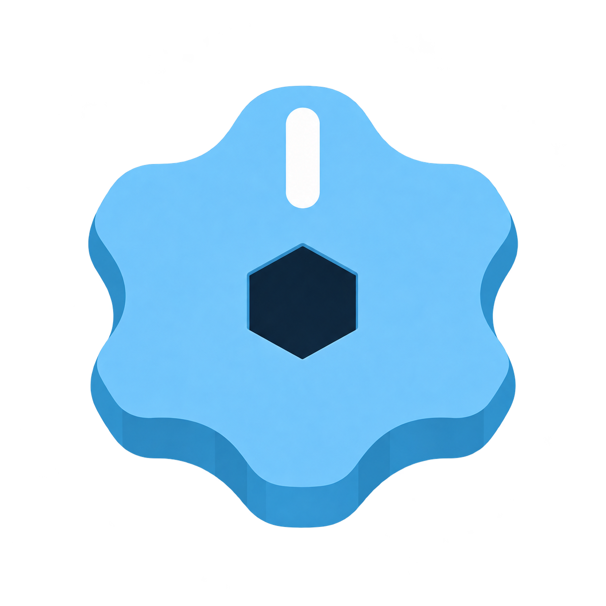
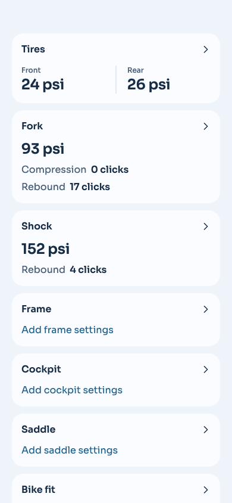
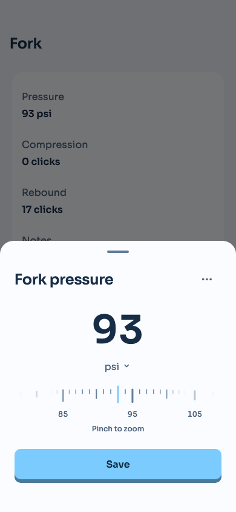
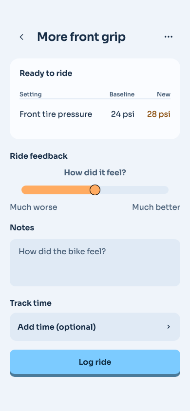

<p align="center">
  
</p>

<h1 align="center">Clickwise</h1>
<p align="center"><strong>Find your setup. Remember what works.</strong></p>
<p align="center">A mountain bike setup journal for the details that make a ride feel right.</p>
<p align="center">
  <a href="#the-app">The app</a> ·
  <a href="#suspension-telemetry">Suspension telemetry</a> ·
  <a href="#development">Development</a>
</p>

## The app

A few clicks of rebound. A little less tire pressure. A setting you loved last summer but can't quite remember. Clickwise keeps those details together, so the next adjustment starts with what you already know.

- **Keep a baseline.** Save setups for your bikes, from suspension and tires to cockpit and bike fit.
- **Make deliberate changes.** Compare an experiment against its original settings, record ride feedback and track times, then decide what to keep.
- **Stay on top of maintenance.** Keep service history, intervals and repair to-dos alongside the bike they belong to.
- **Bring your mileage along.** Connect Strava to track bike mileage without making it a requirement for using the app.

<table>
  <tr>
    <th>Your setup at a glance</th>
    <th>Dial in the details</th>
    <th>Find what feels better</th>
  </tr>
  <tr>
    <td></td>
    <td></td>
    <td></td>
  </tr>
</table>

*Actual app UI rendered with sample data. Clickwise is in development for iOS and Android; this is not an app-store release.*

## Suspension telemetry

Alongside the app, we're exploring compact magnetic travel sensors for forks and shocks. The goal is to connect how a bike feels with how its suspension moves.

The hardware folder contains mechanical design studies, Fusion projects and STEP/STL exports. These are **prototypes**, not validated riding hardware. Telemetry recording and app integration are still future work.

[Explore the hardware →](hardware/README.md)

## One product, three working areas

| Folder | What's inside |
| --- | --- |
| [`app/`](app/README.md) | Flutter app, assets, native platform projects and app tests |
| [`backend/`](backend/README.md) | Firebase Functions, Firestore rules and backend tests |
| [`hardware/`](hardware/README.md) | Suspension telemetry designs and mechanical prototypes |

Each area keeps its own sources and documentation. Shared GitHub workflows live in `.github/workflows/`.

## Development

The app uses Flutter and Firebase. CI uses **Flutter 3.41.4** and **Node 22**; Firestore rules tests also require **Java 21 or newer**.

Start with the [app setup guide](app/README.md) to configure Firebase and run on a device. For cloud services, secrets and rules testing, use the [backend guide](backend/README.md).

From the repository root:

```sh
cd app
flutter pub get --enforce-lockfile
flutter analyze --fatal-infos
flutter test
cd ../backend/functions
npm test
```

Firebase configuration and credentials stay local. Never commit service-account keys or the Strava client secret. See [development conventions](AGENTS.md) before contributing.

Backend changes pushed to `main` deploy the Firebase Functions and Firestore rules. App-only and hardware-only changes do not trigger that deployment.
