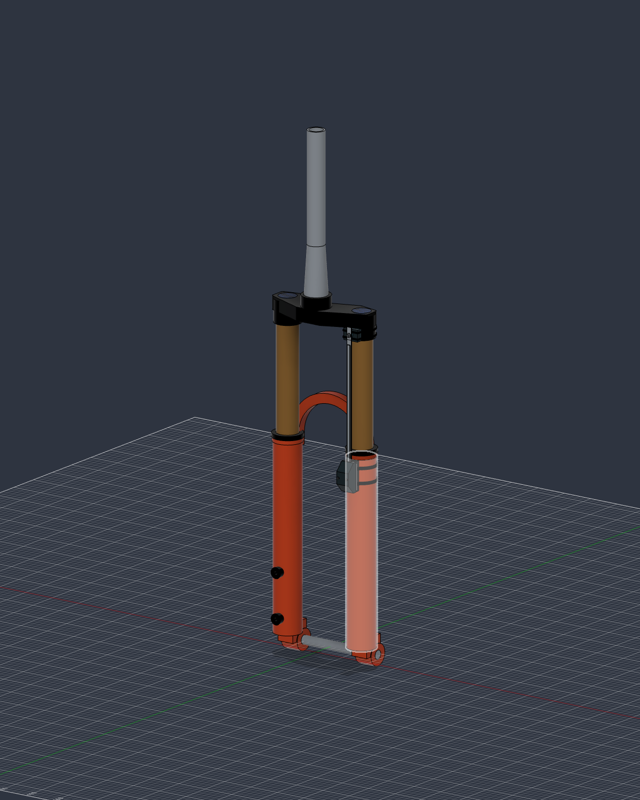

# Clickwise hardware

Mechanical prototypes for compact magnetic suspension-travel sensing on mountain bike forks and shocks.

## Start here

Open [Fork_telemetry.f3d](telemetry/design/Fork_telemetry.f3d) in Fusion. This is the current project, with assembled and exploded views.

| Folder | Purpose |
| --- | --- |
| `telemetry/design/` | Current editable Fusion project |
| `telemetry/exports/` | STEP exports for sharing the current assembly |
| `telemetry/previews/` | Images of the current assembly and mounts |
| `telemetry/development/` | Scripts, required component sources, supplier geometry and validation records |

The development material is not needed to open the current project. Future agents should start with [the continuation guide](telemetry/development/CONTINUING.md).

These are packaging and movement studies, not validated riding hardware. The fork reference is approximate. Real clearances, flex, retention, sealing and durability require physical verification before use.

## Saving design changes

Fusion is the working design environment. Files in this repository are exported snapshots, not automatically synchronized copies of the cloud design.

1. Save your work in Fusion as usual.
2. At a useful milestone, use **File → Export → Autodesk Fusion Archive** to replace the corresponding `.f3d` file here. Assemblies with external references may require `.f3z` instead.
3. Refresh any STEP exports and preview images affected by the change, so they match that archive.
4. Commit the updated files together with a short description of what changed.

You do not need to export after every adjustment. Export when you want the repository to capture a new design revision. Prefer a stable filename per design going forward; Git records revisions, so new `_v9`, `_v10` copies are unnecessary. Keep only current design files and the sources they require.

For frequent binary revisions, Git LFS is a suitable next step. It stores binary contents separately from Git history, but does not synchronize Fusion or make CAD changes mergeable. LFS is not configured in this repository yet.

[Autodesk: saving local archives](https://help.autodesk.com/view/fusion360/ENU/?caas=caas%2Fsfdcarticles%2Fsfdcarticles%2FHow-to-save-3d-file-in-local-drive-in-Fusion-360.html)
